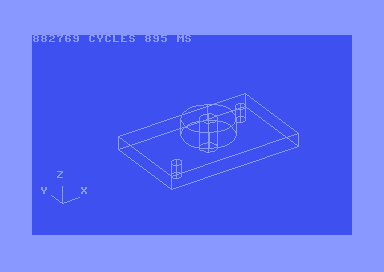

# SolidCraft 64

**Parametric CAD for the Commodore 64.** Sketch a rectangle or a circle, type
its dimensions, extrude it, and turn it round in wireframe, in 320 x 200 and
two colours. Save it to the floppy. Export an STL, slowly.

```
    **** COMMODORE 64 BASIC V2 ****
 64K RAM SYSTEM  38911 BASIC BYTES FREE

READY.
LOAD"SOLIDCRAFT",8,1

SEARCHING FOR SOLIDCRAFT
LOADING
READY.
RUN
```

SolidCraft 64 is a parody. It is not affiliated with, endorsed by, or a
replacement for SolidCraft. It is the third member of the family, after
[SolidCraft 98](https://github.com/raykholo/solidcraft98) and
[SolidCraft 2000](https://github.com/raykholo/solidcraft2000), and the only
one with a cassette port it doesn't use.

## Status

Under construction. The parts below arrive in this order:

1. The wireframe: sketch, extrude, rotate with the cursor keys or a joystick in port 2.
2. Files: `.SC64` parts on the disk, ASCII STL export, and a converter on your PC
   that brings SolidCraft 98 and SolidCraft 2000 parts over.
3. The splash, the menus, the feature list, and loading at the speed of a real
   1541 (about 400 bytes a second), border flashing. A fast loader cartridge is
   available, as it was.

## The wireframe

Hi-res bitmap mode, 320 x 200, light blue on blue, because that is what the
machine does when you switch it on and nobody has ever improved on it. One
foreground colour and one background colour for the whole screen. The hi-res
colour matrix is a rounding error you only have to fill once.



- **Lines** are Bresenham in 6502 assembly (`src/line.s`), all eight octants,
  with the KERNAL banked out while they run so the bitmap can be read and ORed.
  The pointer into the bitmap is stepped, not recomputed. `src/clip.c` clips to
  the screen first, which almost never matters, because the part is fitted to a
  sphere of 92 pixels. `make viewdemo` builds a harness; its `T` key checks 64
  lines (edges, diagonals, random) pixel for pixel against a second
  implementation. All 64 agree.
- **3D** is orthographic, in eighths of a pixel, with a 256-step sine table
  (`tools/gensin.py` made it) and two hand-written multiplies, because cc65's
  `long` multiply costs a few thousand cycles and these cost about 500 and 1,100. Yaw and
  pitch; the cursor keys turn the part in steps of 1/64 of a turn.
- **Geometry**: rectangles, circles as 24-gons, extrudes (both loops and the
  verticals), cuts (the same, drawn down from the top face). Circles get four
  verticals, at their left and right silhouette and the two between. A sketch
  with nothing made from it is drawn flat. The origin triad is bottom left.
- **Speed**: a redraw of a 10-feature part (plate, boss, three holes: 4 circles,
  1 rectangle, 220 lines) takes about 880,000 cycles, which is 0.89 s on a PAL
  machine at 985,248 Hz. The viewdemo prints the number after every redraw, from
  the CIA timers. Warp mode does not change it.

Other angles: [2](docs/screenshots/wire-2.png), [3](docs/screenshots/wire-3.png).

## Building

You need [cc65](https://cc65.github.io). Then:

```
make          # build/solidcraft.prg
make d64      # build/solidcraft.d64, with the samples
```

To run it, open the `.d64` in [VICE](https://vice-emu.sourceforge.io) (`x64sc`)
or on a real Commodore 64 with a 1541 or an SD2IEC.

cc65 and VICE are tools only; neither is part of this project. No Commodore ROM
is in this repository or its releases. See [NOTICE](NOTICE).

## Files

| | |
|---|---|
| `src/model.h` | the part in memory, shared by everything |
| `src/sc64.cfg` | the linker's memory map ([docs/MEMORY.md](docs/MEMORY.md)) |
| `docs/FORMAT.md` | the `.SC64` part file |
| `tools/ci/` | the CI scripts and a local test image |

MIT License. See [LICENSE](LICENSE).
