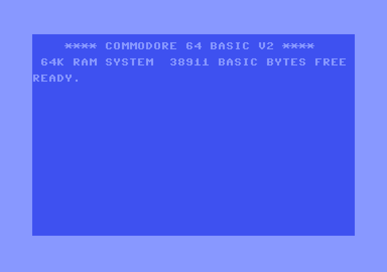
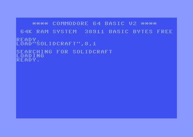
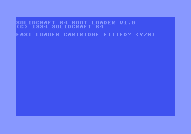
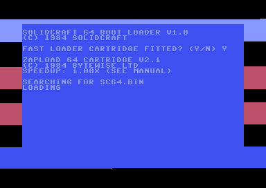
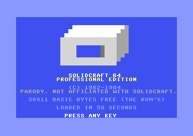
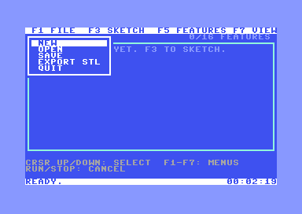
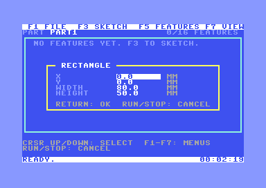
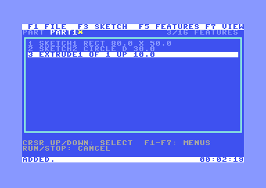

# SolidCraft 64

**Parametric CAD for the Commodore 64.** Sketch a rectangle or a circle, type
its dimensions, extrude it, and turn it round in wireframe, in 320 x 200 and
two colours. Save it to the floppy. Export an STL, slowly.

```
    **** COMMODORE 64 BASIC V2 ****
 64K RAM SYSTEM  38911 BASIC BYTES FREE

READY.
LOAD"SOLIDCRAFT",8,1

SEARCHING FOR SOLIDCRAFT
LOADING
READY.
RUN
```

SolidCraft 64 is a parody. It is not affiliated with, endorsed by, or a
replacement for SolidCraft. It is the third member of the family, after
[SolidCraft 98](https://github.com/raykholo/solidcraft98) and
[SolidCraft 2000](https://github.com/raykholo/solidcraft2000), and the only
one with a cassette port it doesn't use.



## Getting it

`solidcraft.d64` is the disk. Put it in [VICE](https://vice-emu.sourceforge.io)
(`x64sc solidcraft.d64`), or on an SD2IEC, or write it to a real floppy if you
still have a drive that works and the patience to wait for it. Then
`LOAD"SOLIDCRAFT",8,1` and `RUN`. It takes about a minute to load. That's the
point. `SHA256SUMS.txt` has the sums.

## The wireframe

Hi-res bitmap mode, 320 x 200, light blue on blue, because that is what the
machine does when you switch it on and nobody has ever improved on it. One
foreground colour and one background colour for the whole screen. The hi-res
colour matrix is a rounding error you only have to fill once.


- **Lines** are Bresenham in 6502 assembly (`src/line.s`), all eight octants,
  with the KERNAL banked out while they run so the bitmap can be read and ORed.
  The pointer into the bitmap is stepped, not recomputed. `src/clip.c` clips to
  the screen first, which almost never matters, because the part is fitted to a
  sphere of 92 pixels. `make viewdemo` builds a harness; its `T` key checks 64
  lines (edges, diagonals, random) pixel for pixel against a second
  implementation. All 64 agree.
- **3D** is orthographic, in eighths of a pixel, with a 256-step sine table
  (`tools/gensin.py` made it) and two hand-written multiplies, because cc65's
  `long` multiply costs a few thousand cycles and these cost about 500 and 1,100. Yaw and
  pitch; the cursor keys turn the part in steps of 1/64 of a turn.
- **Geometry**: rectangles, circles as 24-gons, extrudes (both loops and the
  verticals), cuts (the same, drawn down from the top face). Circles get four
  verticals, at their left and right silhouette and the two between. A sketch
  with nothing made from it is drawn flat. The origin triad is bottom left.
- **Speed**: a redraw of a 10-feature part (plate, boss, three holes: 4 circles,
  1 rectangle, 220 lines) takes about 880,000 cycles, which is 0.89 s on a PAL
  machine at 985,248 Hz. The viewdemo prints the number after every redraw, from
  the CIA timers. Warp mode does not change it.

Other angles: [2](docs/screenshots/wire-2.png), [3](docs/screenshots/wire-3.png).

## Loading

```
LOAD"SOLIDCRAFT",8,1
RUN
```



`SOLIDCRAFT` is a 664-byte boot loader. It asks whether a fast loader
cartridge is fitted, then reads `SC64.BIN` from the disk through the KERNAL,
one byte at a time, changing the border colour with every byte. That is the
stripes.



It loads at the speed of a real 1541. In VICE with true drive emulation (not
warp), the 13.8 KB program takes **29 seconds**, and the splash screen tells
you how long yours took. Nothing in the loader goes faster than the drive.



**The fast loader cartridge.** Answer Y and the loader introduces a ZAPLOAD 64
cartridge, from Bytewise Ltd, which does not exist. It then loads exactly as
slowly as before and prints `SPEEDUP: 1.00X (SEE MANUAL)`. We did not write a
fast loader. A real one has to upload its own code into the 1541, and the joke
is better when the cartridge is honest about it.

## Using it



The keys are on the menu bar. F1 FILE, F3 SKETCH, F5 FEATURES, F7 VIEW. Cursor
left and right move between menus, cursor up and down choose, RETURN selects,
RUN/STOP backs out.

| Menu | |
|---|---|
| F1 FILE | NEW, OPEN, SAVE, EXPORT STL, QUIT |
| F3 SKETCH | RECTANGLE, CIRCLE |
| F5 FEATURES | EXTRUDE, CUT, DELETE (the highlighted feature) |
| F7 VIEW | WIREFRAME, TURBO, ABOUT |



Dimensions are typed in millimetres with one decimal place (`80`, `12.5`,
`-3.0`), and stored in tenths. RETURN or the cursor keys move between fields;
RUN/STOP cancels.



The feature list holds 16 features. Pick one with cursor up and down. An
asterisk after the part's name means it has changed since it was saved, and
NEW, OPEN and QUIT ask `ARE YOU SURE? (Y/N)` before losing it.



WIREFRAME switches to the 320 x 200 view. The cursor keys, or a joystick in
port 2, turn the part. RUN/STOP comes back.

The clock at the bottom right is `TI$`, and counts from power on. TURBO is in
the VIEW menu. It switches on, says so, and changes nothing. Fill the feature
list and the screen says `?OUT OF MEMORY  ERROR`. It isn't one.

## Building

You need [cc65](https://cc65.github.io). Then:

```
make          # build/boot.prg (SOLIDCRAFT) and build/solidcraft.prg (SC64.BIN)
make d64      # build/solidcraft.d64: both, and the samples
make test     # the converter's and mkd64's unit tests
```

To run it, open the `.d64` in [VICE](https://vice-emu.sourceforge.io) (`x64sc`)
or on a real Commodore 64 with a 1541 or an SD2IEC.

CI builds it with cc65, then drives it in VICE through the binary monitor
(`tools/ci/smoke.py`): it loads off the disk with true drive emulation, sketches,
extrudes, cuts, turns the wireframe, saves, exports an STL and opens a converted
part, then reads the disk back and checks what the C64 wrote. The animation at
the top is that test's screenshots.

cc65 and VICE are tools only; neither is part of this project. No Commodore ROM
is in this repository or its releases: CI takes the ROMs from VICE's own source
release while the test runs. See [NOTICE](NOTICE).

## Files on the disk

Parts live on drive 8 as `.SC64` files, which are plain text you can read
with a BASIC loop ([docs/FORMAT.md](docs/FORMAT.md)). File > Save writes one,
File > Open reads the directory and loads one, and File > Export STL writes a
`.STL` beside it.

- **Names.** A Commodore file name is 16 characters, so the part's name goes
  on the disk as its first 11 characters (A-Z, 0-9, space and hyphen) and
  `.SC64`. `MOUNTING PLATE` is `MOUNTING PL.SC64` on the disk and is still
  called `MOUNTING PLATE` when you open it. Two parts whose first 11
  characters agree are the same file.
- **Saving** scratches the old copy and writes a new one. The 1541's
  save-with-replace (`@0:`) has a long-standing bug that can break the file's
  block chain, so we don't use it.
- **Opening a bad file** says so and leaves the part you had alone. A file is
  refused if its first line isn't `SC64 1`, if a line doesn't parse, if it has
  no `END`, or if it has more than 16 features.
- **STL** is ASCII, in millimetres. A rectangle extrudes to a box and a circle
  to a 16-sided prism. Each extrude is a `solid PART`. SolidCraft 64 does not
  subtract: each cut is written as a `solid CUT`, the shape of the tool, and the
  subtracting is for your slicer or CAD (a negative part or modifier will do
  it). That is how SolidCraft 2000 keeps bodies that don't join, too. At
  1541 speed the Mounting Plate (a plate, a boss and five holes) is 53 KB of
  STL, which is a coffee.

If a save or a load fails, the number it shows is the drive's own error (62 is
file not found, 72 disk full, 26 write protected) or one of ours: 90 not a part,
91 a line it can't read, 92 cut short, 93 too long.

## Bringing parts over from SolidCraft 98 and 2000

`tools/convert.py` runs on your PC (Python 3, nothing to install) and turns a
SolidCraft 98 `.sc98` or SolidCraft 2000 `.sc2` part into `.SC64`:

```
python3 tools/convert.py "Mounting Plate.sc98" -d parts          # parts/MOUNTING PL.SC64
python3 tools/convert.py *.sc2 -o parts.d64 --prg build/solidcraft.prg   # straight onto a disk image
python3 tools/mkd64.py build/solidcraft.d64 build/solidcraft.prg samples/*.SC64   # what make d64 does
```

Rectangles, circles, extrudes and holes come over. A hole becomes a circle and
a cut, so a bolt circle of four is eight features and the part's 16 go quickly.
Whatever doesn't come over gets a line on stderr, in the usual voice:

```
Fillet1: SolidCraft 64 doesn't do fillets. The corners are sharp, as in 1982.
```

Lengths are rounded to 0.1 mm. `samples/` has the Mounting Plate and the
Filleted Plate (fillets dropped) from SolidCraft 2000's own samples, and a
Flange, made from a bolt-circle pattern; the originals are in `samples/in/`.

### What SolidCraft 64 can't open

- `.solidcraft` files, the real SolidCraft's (a zip of constrained sketches).
- Anything with more than 16 features: the last ones are left out.
- Fillets, chamfers, revolves, sheet metal, and anything from another SolidCraft.
- Rounded rectangle corners (they come over square), and sketches on a side face.
- Suppressed features. Feature names, parameters and the timeline.
- Parts bigger than 3276.7 mm, and lengths finer than 0.1 mm.
- Hole patterns that don't fit in what's left of the 16 features.

## What's in the repository

| | |
|---|---|
| `src/main.c` | the splash, the menus, the dialogs, the feature list |
| `src/view.c`, `src/line.s`, `src/clip.c` | the wireframe: 3D in C, lines in 6502 |
| `src/files.c` | `.SC64` parts, STL and the directory, on drive 8 |
| `src/boot/` | `SOLIDCRAFT`, the boot loader, and the cartridge question |
| `src/model.h` | the part in memory, shared by everything |
| `src/sc64.cfg` | the linker's memory map ([docs/MEMORY.md](docs/MEMORY.md)) |
| `docs/FORMAT.md` | the `.SC64` part file |
| `tools/mkd64.py` | builds the `.d64` (and reads one back) |
| `tools/convert.py` | SolidCraft 98 and 2000 parts to `.SC64` |
| `tools/ci/` | the CI scripts, the VICE driver and a local test image |

MIT License. See [LICENSE](LICENSE).
